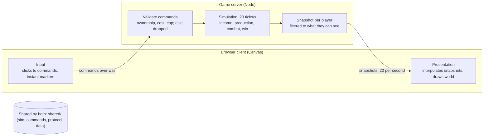
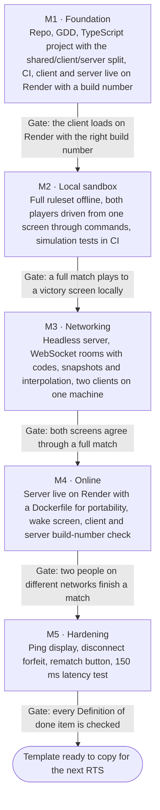

# Another RTS — Game Design Document

Last updated 2026-10-28 · Owner: Marz

> This file is the source of truth for Another RTS. If it disagrees with any other copy (chat drafts, docs elsewhere), this file wins.

**Another RTS** is built from `MarcialPimentel/rts-template` v1.0 (the `upstream` remote). The Core sections below come from the template unchanged. The Game layer section describes this game: a short, shape-based RTS about trading off economy, army and tech.

## How to use this template

This is the reference design for every RTS built from this repo: a minimal two-player browser RTS that proves online multiplayer, plus the rules any future RTS must keep. The proof-of-concept game (one Town Hall, one Barracks, one Soldier) is deliberately small; the architecture is the product.

The document has two layers:

- **Template core** (sections marked *Core*): architecture, simulation, commands, networking, project layout, deployment and testing. Future games reuse these unchanged. Changing a Core rule is a deliberate decision recorded in the Decision log.
- **Game layer** (sections marked *Game layer*): content, stats, map and win condition. Every new game replaces this layer.

**Starting a new game from this template:** copy the repo, keep every Core section, rewrite the Game layer section, and add the new game's decisions to the Decision log.

### Rules for AI sessions

Any AI session working on this repo or a game built from it must:

1. Read this document before proposing designs or writing code.
2. Treat **MUST** rules as invariants. If a task seems to require breaking one, stop and raise it instead of working around it.
3. Treat **SHOULD** rules as strong defaults that can be changed with a stated reason.
4. Keep each pull request to one milestone issue, and keep game content in data files rather than code.
5. Update this document in the same pull request when a change affects anything it describes.

## Proof of concept scope *(Core)*

The PoC is done when two people on different networks, each in a browser, can play a full match from lobby to victory screen with responsive controls and both seeing the same result.

**Status (2026-10-27):** done. Two full matches were played on the live build between different networks, including the 150 ms latency check.

**Definition of done:**

- [x] Player 1 creates a room and gets a short room code; Player 2 joins with it.
- [x] Both players issue commands and see each other's units act on them.
- [x] Clicks are acknowledged instantly on screen, even at 150 ms round-trip latency.
- [x] Combat resolves identically for both players.
- [x] Destroying the enemy Town Hall ends the match with a win/lose screen for each player.
- [x] A player who disconnects for more than 30 seconds forfeits.
- [x] The client shows a clear message while the server wakes from sleep.

**Out of scope for the PoC:** workers and harvesting, building placement, fog of war, more than two players, matchmaking, accounts, reconnection to a match in progress, client-side movement prediction, sound beyond click feedback, and art beyond simple shapes.

## Architecture invariants *(Core)*

The server owns the only real game; clients send commands and draw what the server tells them. Every rule below is a **MUST**.

1. **Server-authoritative.** The game server runs the one true simulation. Clients never change game state directly, and the server never trusts a client's claim about state.
2. **Commands as data.** Every player action is a command: a small data object sent to the server, validated, and applied on the next tick. Input handling, AI opponents, replays and tests all produce the same commands.
3. **Simulation separate from presentation.** Simulation code has no nodes for sprites, sound, input or UI, and never reads from them. Presentation reads simulation state and draws it. The simulation must run headless.
4. **Fixed tick.** The simulation advances in fixed steps of 50 ms (20 ticks per second), independent of frame rate. All durations and speeds in data files are in seconds and converted to ticks at load.
5. **One codebase, two targets.** Server and client are one TypeScript repo sharing `shared/` (simulation, commands, protocol, data). The server is a Node process; the client is a browser bundle. Neither duplicates game rules.
6. **Data-driven content.** Units, buildings and costs are defined in `shared/data/`, not inside systems. Adding a unit type requires no simulation code change unless it needs a new ability.
7. **Portable server.** The server is a plain Node process with a Dockerfile, so hosting can move between providers without code changes.
8. **Toolchain pinned.** The Node version is in `.nvmrc` and package versions are locked in `package-lock.json`. Upgrades happen in their own pull request.



The client never changes the world itself: its clicks become commands, and what it draws comes only from server snapshots.

## Simulation model *(Core)*

The simulation is a plain state object advanced one tick at a time by a fixed sequence of systems.

**World state** holds the tick number, each player's resources and status, a map of entities keyed by integer ID, and the deaths of the last second (so clients under fog of war can tell a death from a unit leaving their sight). It is plain JSON-serializable data, so it can be sent as a snapshot as is. The server assigns IDs and never reuses them within a match.

**Entities** have an ID, an owner, a type ID pointing at its definition, a position, current HP, and optional components: `mover` (target, speed), `attacker` (target, cooldown), `producer` (queue, progress), `income` (amount per second) and, for capture points, `capture` (who is capturing, progress). Systems act on whichever components an entity has. Neutral capture points have owner `-1`.

**Definitions** are typed data objects in `shared/data/`, one per unit or building type, holding cost, HP, speed, damage, range, attack interval, build time and which components it gets. A game's whole roster lives here.

**Tick order** (SHOULD stay stable, since order affects outcomes):

1. Apply queued commands, in arrival order, after validation.
2. Income: add resources.
3. Production: advance queues; spawn finished units at the building's rally point.
4. Targeting: idle and attack-moving units acquire the nearest enemy in sight range.
5. Movement: move toward targets; apply simple separation so units don't stack.
6. Combat: units in range with a ready cooldown deal damage.
7. Deaths: remove entities at 0 HP, clear references to them, and remember each death for one second.
8. Capture: advance or drain capture progress on each point (after deaths, so units killed this tick don't count).
9. Win check: a player with no HQ loses.

**Movement** in the PoC is straight-line with separation on an open map. Pathfinding is an extension point, added behind the movement system without changing commands.

**Randomness**, if ever needed, MUST come from a seeded generator owned by the simulation, so tests and replays are reproducible.

## Command protocol *(Core)*

Seven commands cover the game so far; every one is validated by the server and silently dropped if invalid.

Each command carries `type`, a client-side sequence number `seq` (so the client can match acknowledgments), and its arguments. The server stamps the sending player's ID itself; a `player_id` sent by a client is ignored.

| Command | Arguments | Server validation |
| --- | --- | --- |
| `move` | unit IDs, target position | Units exist, belong to sender, can move; position clamped to map |
| `attack` | unit IDs, target entity ID | Units belong to sender; target exists and is an enemy |
| `attack_move` | unit IDs, target position | As `move`; units engage enemies met on the way |
| `stop` | unit IDs | Units belong to sender |
| `train` | building ID, unit type ID | Building belongs to sender and can produce that type; sender can afford it; queue not full; unit cap not reached |
| `set_rally` | building ID, position | Building belongs to sender and is a producer |
| `research` | building ID, research ID | Building belongs to sender and offers it; sender isn't researching, doesn't have it yet, has its requirements and can afford it |

Rules:

- Commands MUST describe intent, never results. `move` says where to go, not where a unit now is.
- Unit ID lists SHOULD be capped (64 per command) to bound message size.
- New commands are added by defining the schema here, a validator, and an apply function. Nothing else in the network layer changes.

## Network protocol *(Core)*

Clients talk to the server over secure WebSockets; commands go up, and each player's snapshot of what they can see comes down 20 times a second.

**Transport.** The browser's native `WebSocket` on the client and the `ws` library on the server, over `wss://` (browsers cannot use UDP, and an HTTPS page requires secure sockets). TLS is terminated by the host. Messages are JSON, typed in `shared/protocol.ts`. Messages SHOULD go through a thin `NetProtocol` layer so the transport or encoding can be swapped (for example to WebRTC or binary) without touching game code.

**Rooms.** One server process hosts many rooms. Each room has its own simulation, a 4-letter code (letters only, no I, L or O), and exactly two player slots. Lifecycle: `waiting` (the lobby) → `countdown` (3 seconds) → `playing` → back to `waiting`. In the lobby each player picks a colour (not one the other player holds) and presses Ready; the countdown starts when both players are present and ready, and unreadying or leaving cancels it. After a match the room returns to the lobby with Ready cleared, so the same pair can play again. Empty rooms are deleted after 60 seconds.

**Messages** (exact types in `shared/protocol.ts`):

| Direction | Message | Purpose |
| --- | --- | --- |
| Client → server | `create_room` | Make a room, receive its code |
| Client → server | `join_room` | Join by code |
| Client → server | `command` | One command with the client's `seq` (see Command protocol) |
| Client → server | `ping` | Latency measurement |
| Client → server | `set_color` | Lobby: pick a colour (index into `PLAYER_COLORS` in `shared/lobby.ts`) |
| Client → server | `set_ready` | Lobby: ready or unready |
| Client → server | `leave` | Leave the room (mid-match, this forfeits immediately) |
| Server → client | `hello` | Sent on connect with the server's build number |
| Server → client | `room` | Lobby status: code, phase, your slot, who's connected, colours, who's ready, countdown |
| Server → client | `error` | Unknown room, full room, or malformed message |
| Server → client | `match_start` | Your player slot, both players' colours, and the entity type list for decoding snapshots |
| Server → client | `snapshot` | Tick number, your last applied `seq`, the entities and resources you can see, recent deaths, match result |
| Server → client | `match_end` | Winner and reason |
| Server → client | `opponent_disconnected` | The opponent dropped; time until they forfeit |
| Server → client | `pong` | Latency reply |
| Server → client | `room_closed` | The room was cleaned up |

**Snapshots.** The server sends each player the state every tick (20 Hz), filtered by fog of war to what that player can see (see Camera and fog of war), including each player's research and recent deaths, encoded compactly: each entity is a short array of rounded numbers, so a 60-unit battle is under 3 KB, and WebSocket compression shrinks it further. This matters on free hosting with a monthly bandwidth allowance. Delta compression is an extension point for when unit counts grow.

**Interpolation.** Clients render about 100 ms behind the newest snapshot and interpolate positions between the two snapshots around that time. This hides jitter at the cost of a small, constant delay.

**Disconnects.** A player whose socket closes during a match has 30 seconds before forfeiting; the opponent sees a countdown banner. A player who leaves on purpose forfeits immediately. Reconnecting into that window is out of scope for the PoC, so in practice a disconnect is a loss.

## Client presentation and UX *(Core)*

The client must feel instant even though nothing happens until the server confirms it: acknowledge every input the moment it is made.

**Controls (standard RTS conventions, SHOULD keep):**

- Left-click selects a unit or building; drag selects a box of own units; Shift adds to selection.
- Right-click on ground: `move`. Right-click on an enemy: `attack`. `A` then left-click: `attack_move`. `S`: `stop`.
- With a Barracks selected: one Train button per unit it can make (hotkeys `Q`, `W`, `E`, `R` in the order the data lists them) sends `train`; right-click on ground sends `set_rally`.
- With the HQ selected: one Research button per upgrade (hotkeys `Q`, `W`, `E`, `R`) sends `research`.
- Camera pans with edge scrolling, arrow keys and middle-mouse drag, at the same on-screen speed at any zoom. The mouse wheel (or `+`/`-`) zooms toward the cursor, from 1.6× in to the whole map fitting the window, but never below 0.5× so shapes stay readable. The first view fits the map's height. `Space` centres on your HQ.
- **Minimap** in the bottom-right of the HUD: the whole map with points, buildings and units in player colours and the camera's view as a box. Left-click or drag moves the camera; right-click moves the selected units (or sets the rally point) there.

**Instant feedback (MUST).** On any command, immediately show a marker at the click point (green for move, red for attack) and play a short click sound, before the server responds. Training shows the queued unit at once, greyed out until the snapshot confirms it.

**HUD:** gold, unit count against cap, the selected entity's HP and production queue, ping in milliseconds, the minimap, and the room code while waiting.

**Readability:** each player keeps the colour they picked in the lobby on every entity they own, on both players' screens, so both players agree on who is who. HP bars show above damaged entities. The local player's base is always shown on the left of the map for orientation (player 2's view is mirrored).

**Lobby:** after creating or joining a room, players see the room code and invite link, both player slots with their colour and Ready state, a colour picker, and a Ready button. The countdown shows in the lobby. After a match, "Back to lobby" returns there for another round.

**Sandbox** (`?sandbox`): the same game screen driven by a local copy of the simulation, with Tab switching between players. Useful for testing rules and content without a server.

**Server wake screen (MUST).** If the server does not answer within 2 seconds, show "Waking up the server, this can take up to a minute" with a progress indicator, and keep retrying. Never show a silent hang or a raw connection error during a cold start.

## Game layer: Another RTS *(Game layer)*

Two commanders fight over a small map with shape-based armies. Every coin goes to **army** (win fights now), **economy** (earn more later) or **tech** (make every later unit better), and that three-way choice is the game. Matches last under 10 minutes.

**Design pillars:**

1. **Economy vs army vs tech.** One currency (gold) funds all three, so every purchase is a trade-off you can read. A second resource is only added if tech needs its own pressure.
2. **Shapes first, flavour later.** Units are geometric shapes with clear silhouettes. The theme gets painted on once the systems play well; until then readability beats looks.
3. **Systematic and modular.** Each mechanic is one system (or one data field) with its own tests and its own place in the tick order, added one milestone at a time. New units should be data, not code.
4. **Short matches.** Target 6–9 minutes, hard ceiling 10. Prefer mechanics that force a result (map control, victory points) over ones that reward turtling.

**Status (2026-10-28):** G1–G3 are built; G3 is ready to playtest. G4 (camera and fog of war) is built and ready to playtest. Sections below mark what is **built** and what is **planned**.

### Army: four shapes and a counter loop *(built in G1)*

Both players share one roster, trained at the Barracks. Siege needs Tier 2 (see Tech). Counters come from two data fields, not special code: **armour** (flat reduction per hit, minimum 1 damage) and **bonus damage against tags** (`light`, `heavy`, `structure`). Fast, weak hits lose to armour; big hits ignore it.

| Shape | Unit | Role | Strong vs | Weak vs |
| --- | --- | --- | --- | --- |
| ■ Square | Line | Armoured melee front line | Raiders (armour shrugs off their small hits) | Ranged (bonus vs heavy) |
| ▲ Triangle | Raider | Fast, fragile skirmisher; captures points faster (G2) | Ranged, Siege (closes the gap fast) | Line |
| ● Circle | Ranged | Damage from behind the line | Line, Siege (bonus vs heavy) | Raiders |
| ⬢ Hexagon | Siege | Very long range, slow, big hits; an escort is required | Buildings (bonus vs structure) | Every unit in an open fight, Raiders most of all |

Stats live in `shared/data/game.ts` and are tuned there; the table in that file is the current truth. Starting values:

| Entity | Tags | Cost | HP | Armour | Build (s) | Speed (px/s) | Damage / interval (s) / range (px) | Bonus |
| --- | --- | --- | --- | --- | --- | --- | --- | --- |
| HQ | structure | — | 2000 | 3 | — | — | — | Gives 5 gold/s; losing it loses the match |
| Barracks | structure | — | 1000 | 3 | — | — | — | Trains all four units; queue of 5 |
| Line | heavy | 60 | 160 | 2 | 6 | 70 | 10 / 1.0 / 20 | — |
| Raider | light | 50 | 75 | 0 | 4 | 140 | 7 / 0.6 / 15 | — |
| Ranged | light | 70 | 70 | 0 | 6 | 80 | 10 / 1.0 / 140 | ×3 vs heavy |
| Siege | heavy | 120 | 120 | 1 | 9 | 50 | 36 / 3.0 / 260 | ×3 vs structure |

The counter loop is checked by equal-gold battle tests in `tests/balance.test.ts` at 300, 600 and 1200 gold per side: Line beats Raider, Raider beats Ranged and Siege, Ranged beats Line and Siege, and Siege kills an HQ at least 1.5× faster than anything else for the same gold. A stat change that breaks the loop fails CI.

**Combat feedback (built in G1):** each unit draws as its shape in its owner's colour, a little larger than its collision circle so shapes read at a glance; Raider triangles point where they face. Units never draw smaller than 7 px in radius on screen, so the shapes still read when zoomed out. Attacks show as a slash for melee and a tracer for ranged and siege, hit units flash, and dying units burst. Snapshots carry each attacker's target and how long ago it last fired so both players see the same shots.

### Economy: capture points *(built in G2)*

The HQ pays a steady 5 gold/s and **capture points** pay on top of it, so holding the map turns into more army and tech. Points need no pathfinding: they're circles on open ground.

- **Map:** 5 points, mirrored. One safe point near each base, two contested side points (top and bottom of the middle line), and the centre point.
- **Capturing:** a unit counts while its centre is inside the point's circle. Each unit adds its capture weight (1, Raiders 2), capped at 3 per point, so one Line takes 8 s, one Raider 4 s, and three Lines (or two Raiders) about 2.7 s.
- **Enemy points** are made neutral first (one full bar), then captured (a second bar).
- **Contested:** while units of both players are on a point, progress pauses. Fight to clear it.
- **Kept after leaving:** a point stays yours until the enemy neutralizes it. Every point can be captured, including the safe one by your base.
- **Unfinished progress** drains back at one unit's rate when nobody is on the point. The owner standing on their point wipes out an enemy's partial capture.
- **Points can't be attacked:** units never target them, attack commands on them are dropped, and units walk over them. Clicks on a point select nothing; right-click moves there.
- **Income:** HQ 5 gold/s; safe and side points +2 gold/s each; centre +3 gold/s. Holding your half (safe + one side) gives 9 gold/s against 5 with no points.
- **Readability:** neutral points are grey dashed circles; owned points are tinted solid in the owner's colour. A ring fills in the capturing player's colour. Each point shows its income (+2, +3). The HUD shows gold per second and points held by each side.
- **Economy investment (G3):** *Overclock*, researched at the HQ, adds income per owned point. Strong when you hold the map, wasted when you don't.

### Tech: tiers and upgrades *(built in G3)*

Tech is bought at the HQ with the same gold as army and economy. Research is per player, runs one at a time, is paid when it starts, and can't be cancelled. Both players can see each other's tech in the top bar (e.g. `T2 W1 A0 OC`).

| Research | Cost | Time (s) | Needs | Effect |
| --- | --- | --- | --- | --- |
| Tier 2 | 250 | 30 | — | Unlocks Siege, level 2 upgrades and Overclock |
| Weapons 1 | 150 | 20 | — | All your units deal +15% damage |
| Armour 1 | 150 | 20 | — | All your units take 15% less damage |
| Weapons 2 | 250 | 25 | Weapons 1, Tier 2 | Another +15% (30% total) |
| Armour 2 | 250 | 25 | Armour 1, Tier 2 | Another 15% less (30% total) |
| Overclock | 150 | 25 | Tier 2 | Each capture point you own pays +1 gold/s |

- **Tier 1** trains Line, Raider and Ranged, a complete counter loop from the first minute. **Tier 2** unlocks Siege, the unit that ends games. Units name their requirements in a `requires` field.
- **Upgrades are percentages**, the same for every unit, so the counter loop holds at every upgrade level (tested). Weapons multiplies damage before flat armour; Armour multiplies the damage that gets through.
- **Research is data** (`research` in `shared/data/game.ts`): cost, time, requirements, the level it `follows`, and its effect (damage, armour, point income). Effects from everything a player has researched add up.
- **HQ panel:** one button per upgrade (Tier 2, Weapons, Armour, Overclock on Q/W/E/R). A button moves on to the next level once the previous one is done, and locked buttons say what they need. The Barracks shows locked units as "needs Tier 2".
- **No building placement yet.** Tech lives in the pre-placed HQ.

### Camera and fog of war *(built in G4)*

The map is bigger than one screen at a comfortable zoom, so players move the camera and zoom (see Controls), with a minimap for the whole picture. Map size stays 2400 × 1000: zoomed out, the whole map fits a typical browser window.

**Fog of war:** you only see enemy units within sight of your own units and buildings.

- **Vision:** every unit and building sees a circle of its own radius plus its `sight` (the same distance idle units notice enemies at). Sight: Line 250, Raider 280, Ranged 280, Siege 300, HQ 350, Barracks 300 px. An enemy is visible while any part of it is inside one of your circles.
- **The server filters** each player's snapshot (`PlayerVision` in `shared/sim/vision.ts`), so hidden units never reach the client: no cheating through dev tools. The sandbox runs the same filter for the player being controlled.
- **Enemy buildings** are always shown (they're pre-placed), but their HP only updates while seen, and their production queue and rally point are never shown.
- **Capture points:** ownership is always shown; capture progress only where you can see, and always on your own points. While the enemy is taking one of yours, a red ring pulses around it (above the fog), the minimap point pulses, and the top bar warns "a point is under attack".
- **Hidden info:** enemy gold is never sent. Enemy research stays public in the top bar for now.
- **Look:** inside your vision draws normally; outside is desaturated and darkened (about 40%), with soft edges, and the minimap shows the same. No black unexplored layer: the map is small, mirrored and known.
- **Fades:** enemy units fade in as they come into sight and fade out where last seen as they leave it; only real deaths (from the snapshot's death list) burst.
- When the match ends, everything is revealed.

### Win condition and pacing *(planned, G5)*

- **Victory points:** each owned capture point earns victory points every second; the first player to the target wins. Destroying the enemy HQ also wins at once. Opponent disconnect for 30 seconds still forfeits.
- **Target pacing:** 0:00–1:30 take your safe point and race Raiders to the side points; 1:30–4:00 choose between Tier 2, Overclock and more army; 4:00–8:00 fight over the centre and push with Siege.

Until G5, the only win is destroying the enemy HQ (or a forfeit).

### Map and economy (current)

**Map:** 2400 × 1000 px, flat and open, mirrored left to right. Each HQ sits 200 px from its edge. Capture points: safe points at (620, 720) and its mirror, side points at (1200, 160) and (1200, 840), centre at (1200, 500); radius 60 (centre 70). **Economy:** starting gold 200, HQ income 5 gold/s plus points, unit cap 30 units per player (alive plus queued), no upkeep.

### Game milestones

Each milestone ends in something to playtest, tracked on GitHub as a milestone with one issue per task.

| Milestone | Scope | Playtest question |
| --- | --- | --- |
| G1 · Combat foundation | Armour and tag bonuses, the four units as data, shape rendering, attack and hit effects, train hotkeys Q/W/E/R | Do the counters feel right and read clearly? |
| G2 · Capture points | Point entity, capture system, point income, 5-point map, point status in the HUD | Is the map worth fighting over? |
| G3 · Tech | `research` command, tiers, `requires` on units, Weapons/Armour upgrades, Overclock | Is the army/economy/tech choice real? |
| G4 · Camera and fog of war | Zoom, middle-drag pan, minimap; server-filtered snapshots, fog rendering | Does scouting and vision matter? |
| G5 · Win and pacing | Victory points, match timer, balance pass (after fog, since fog changes balance) | Do matches end in 6–9 minutes? |

These numbers are starting points for playtesting, not balanced values. They live in `shared/data/` and are tuned there.

## Project structure *(Core)*

The folder layout enforces the architecture: `shared/` may never import from `client/` or `server/`, and only `shared/data/` changes when a new game swaps its content.

```
another-rts/
  docs/GDD.md              this document
  package.json             one package; scripts for dev, build, test
  .nvmrc                   pinned Node version
  render.yaml              Render Blueprint (server + client)
  shared/                  imported by both client and server; no DOM, no Node APIs
    sim/
      world.ts             world state, entities, tick loop
      systems/             income, production, targeting, movement, combat, deaths, win check
      commands/            one module per command: validate and apply
    data/                  game layer: unit and building definitions, map, economy constants
    protocol.ts            message types, validation and the snapshot codec
    view.ts                drawable view of the world (from the sim or a snapshot)
  server/src/              Node entry point, NetProtocol (ws), room manager, room loop
  client/src/
    game/                  game screen: Canvas rendering, camera, input, HUD, feedback,
                           and the Session interface (local sandbox or online)
    net/                   NetProtocol (browser WebSocket), online session, snapshot buffer
    screens/               online flow: connect and wake screen, lobby, rematch
  tests/                   Vitest: simulation tests and server integration tests
  deploy/Dockerfile        portable server container (Render runs Node natively)
  .github/workflows/       typecheck, test and build on every push
```

Rules: `shared/` must run in both a browser and Node, so it uses no DOM or Node-only APIs. TypeScript runs in strict mode everywhere.

## Deployment *(Core; hosts are Game layer choices)*

Both pieces deploy from `render.yaml` on every push to `main`: the client as a free static site that never sleeps, the server as a free Node web service reached at a `wss://` address set in one config value.

| Piece | PoC host | Notes |
| --- | --- | --- |
| Web client | marz.gg/games/rts (SiteGround), published by `.github/workflows/deploy-marz.yml` on every push | Static files, so it loads instantly even while the server sleeps. Needs the four `SITEGROUND_*` repository secrets; skips until they're set |
| Web client (mirror) | Render static site (`another-rts-client`) | Same build; handy if marz.gg is down |
| Game server | Render free web service (`another-rts-server`) | Sleeps after 15 minutes idle; waking takes about a minute |
| Fallback server | Own PC plus a free tunnel, or a ~$5/month VPS | `deploy/Dockerfile`; only the server URL changes |

Rules:

- The server URL MUST be a single config value (`VITE_SERVER_URL` at client build time), never hard-coded in game code.
- Every build shows a build number (commit short hash) on the title screen, and the server reports its build number on connect. A client and server on different builds show a "please refresh" message instead of connecting.
- The server answers `GET /healthz` for Render's health check.
- The page (`index.html`) MUST NOT be cached by the host or browsers; hashed files in `assets/` may be cached forever. `client/public/.htaccess` sets this on SiteGround. Each marz.gg deploy keeps older assets for two weeks, so a page cached before a deploy still loads.

## Testing *(Core)*

Game rules are proven by headless tests that feed commands into the simulation and check the outcome, so AI-written changes are verified without manual play.

- **Simulation tests (MUST, run on every push):** build a world, apply a scripted list of commands, run N ticks, assert on state. Examples: a `train` with too little gold is rejected; 10 Soldiers beat 5; a Town Hall at 0 HP ends the match; commands for another player's units are ignored.
- **Server integration tests (MUST, run on every push once networking exists):** start the real server, connect two scripted clients, create and join a room, play commands through to a result, and check both clients see the same world (through their own fog of war).
- **Two-client local test (each networking PR):** run the server and two browser tabs on one machine, play a match, and confirm both screens agree.
- **Latency test (before calling the PoC done):** play with 150 ms of added latency and confirm controls still feel responsive. Add `?lag=150` to the game URL to simulate it (half on send, half on receive). Measured 2026-10-25: markers, sound and pending trains appear within one frame; units start moving on screen about 255 ms after a click (150 ms round trip + 100 ms interpolation delay + up to one tick).
- **Online playtest (milestone gate):** two people on different networks complete a match against the deployed server.

Tests use Vitest and run in GitHub Actions on every push and pull request.

## Milestones *(Core)*

Five milestones, each ending in something you can play or see, tracked on GitHub as one milestone with issues per task.



M2 is the one to protect: once the game works locally through commands, adding the network in M3 is a contained change instead of a rewrite.

## Extension points *(Core)*

Future games grow the template through these planned seams, none of which change the architecture invariants.

| Feature | Where it plugs in | Notes |
| --- | --- | --- |
| New unit or building | A definition in `data/` | No code unless it needs a new ability |
| New ability (heal, ranged, build) | A new component plus a system in the tick order | Document its place in the tick order |
| Workers and harvesting | `gather` command, resource nodes, carry component | Needs pathfinding first |
| Building placement | `build` command with server-side footprint validation | Client shows a ghost preview |
| Pathfinding | Inside the movement system (a grid A* or flow field) | Commands unchanged |
| Fog of war | Server filters each player's snapshot to what they can see | Only possible because the server is authoritative |
| AI opponent | A server-side bot that emits commands into a room | Same validation as a human |
| Replays | Record match seed plus the command log; replay through the simulation | Requires the seeded-randomness rule |
| Larger battles | Delta-compressed snapshots, lower snapshot rate | Inside `net/` only |
| Reconnection | Rejoin token; server sends a full snapshot on rejoin | Fits the existing 30-second window |
| More than two players | Room slot count and team assignment | Win check becomes "last team standing" |
| Deterministic lockstep | Swap state sync for command broadcast | Only if unit counts reach thousands; requires fixed-point math |

## Decision log and open questions

Record every change to a Core rule here, newest first, with the reason.

| Date | Decision | Reason |
| --- | --- | --- |
| 2026-10-28 | Fog of war (G4): **Core change** — snapshots are now filtered per player instead of the full state to both. Vision is each entity's radius plus `sight`; buildings got sight (HQ 350, Barracks 300). Enemy buildings always shown with last-seen HP; points always show ownership, and capture progress only in vision or on your own points. Enemy gold hidden, research public. The world remembers deaths for one second | Filtering on the server is the only cheat-proof fog. Reusing `sight` keeps one number per unit for "how far it notices" and "how far it sees". The death memory lets clients tell a kill (burst) from a unit leaving sight (fade), even if a frame skips a snapshot |
| 2026-10-28 | New G4 · Camera and fog of war, before win and pacing (now G5). Camera zooms 0.5×–1.6× (out to the whole map fitting the window) with a minimap; map stays 2400 × 1000. Fog will be server-filtered snapshots, drawn as dimmed areas without a black unexplored layer | Owner's call. Zoom and a minimap let players manage the map in any browser window; fog makes scouting and vision matter. Fog changes balance (scouting and map vision now matter), so the balance pass waits for it. Filtering on the server is the only cheat-proof fog |
| 2026-10-28 | Tech (G3): Tier 1 trains Line, Raider and Ranged; Tier 2 unlocks Siege, level 2 upgrades and Overclock. Weapons/Armour are ±15% per level, two levels each. Overclock needs Tier 2. New `research` command; research runs per player inside the production step (tick order unchanged) | Owner's calls. The GDD planned Tier 1 as Line and Raider only, but nothing at Tier 1 would then beat Line, so the opening would be "mass Line"; adding Ranged keeps the counter loop from minute one. Percentage upgrades keep counters intact at every level. Overclock behind Tier 2 makes Tier 2 the gateway to both late army and late economy |
| 2026-10-27 | Capture points (G2): points stay owned until neutralized; every point, including the safe one, can be captured; a contested point pauses; points pay on top of the HQ, which keeps 5 gold/s (was planned to drop to 3). New tick step "Capture" between deaths and win check | Owner's calls: ownership that persists gives Raiders a raiding job and makes territory matter; capturable safe points keep the army vs economy tension at home; a pause on contested points makes the fight decide it. The owner wants to test a high-gold game first, so points add to the HQ instead of replacing part of it |
| 2026-10-27 | Game design: one currency split between economy, army and tech; capture-point income; four shared shape units with an armour/bonus-damage counter loop; tiers and research; victory points; matches under 10 minutes. Built in four milestones (G1–G4) | Design session with the owner. Shapes keep art cost at zero while the systems are proven; capture points avoid pathfinding; victory points stop turtling and keep matches short |
| 2026-10-27 | Another RTS created from rts-template v1.0 with shared history (`upstream` remote). It takes over the marz.gg/games/rts page and the SiteGround secrets; its own Render services are `another-rts-server` and `another-rts-client`, and the template's live deploys are retired | The template isn't played on its own, so the game reuses its page and settings. Only one repo deploys to each place, so template pushes can't overwrite the game |
| 2026-10-25 | Client also published to marz.gg/games/rts from GitHub Actions over SSH; asset paths are relative so one build works at a root or in a subfolder | Wanted the game on the owner's own domain; the server stays on Render because shared hosting can't run it |
| 2026-10-25 | Ready-up lobby with colour choice; players keep their own colour on both screens (was: local player always blue, opponent red); rooms return to the lobby after a match instead of a separate rematch step | Playtest feedback: seeing your own colour swapped on the other screen was confusing, and a lobby before the match was wanted |
| 2026-10-25 | Leaving mid-match forfeits immediately; only dropped connections get the 30 s grace period | Nobody should wait 30 s for a player who chose to leave |
| 2026-10-25 | Compact snapshot encoding plus WebSocket compression | Render's free tier has a small monthly bandwidth allowance |
| 2026-10-25 | Client hosted as a Render static site instead of marz.gg | Loads instantly while the server wakes; deploys from the repo with no manual upload |
| 2026-10-25 | Switched from Godot 4.7.2 to TypeScript (Node server, Canvas client, Vite, Vitest) | One language shared by client and server, small fast-loading client, and the whole game can be built and tested headlessly by AI sessions. Architecture rules are engine-agnostic, so a later port is a code rewrite, not a redesign |
| 2026-10-25 | Godot 4.7.2 pinned | Latest stable release at project start (superseded the same day) |
| 2026-10-25 | Repo `MarcialPimentel/rts-template`; this file is the canonical GDD | One source of truth that AI sessions can be pointed at |
| 2026-10-25 | Barracks pre-placed in the PoC | Building placement is its own UX problem; listed as an extension point |
| 2026-10-25 | Server hosted on Render free tier, with a Dockerfile for portability | Free for under 5 playtesters; a later move to a ~$5 VPS is a config change |
| 2026-10-25 | Server-authoritative state sync over deterministic lockstep | Floating-point determinism across machines isn't guaranteed; desync bugs are hard to debug in AI-written code |
| 2026-10-25 | WebSockets over WebRTC | Browsers cannot use UDP; WebRTC needs a signaling server and has NAT issues |
| 2026-10-25 | No workers in the PoC; passive income | Harvesting adds pathing and AI work without testing networking |

**Open questions:**

- [ ] Render's free-tier limits are current as of October 2026 and change often; recheck before deploying (M4).
